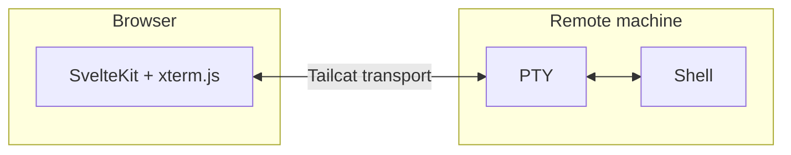

# WebSSH

WebSSH is a project to build a browser-based remote terminal: open a page, connect to a remote machine, and work in an interactive shell without exposing an SSH port to the public internet. It is also a chance to learn by building something useful—trying SvelteKit for the first time, exploring Tailcat’s browser networking, and putting SQLite-backed Cloudflare Durable Objects to work in a real application. The architecture below is the intended direction; the project is not implemented yet.

## Connecting to remote machines

[Tailscale](https://tailscale.com/docs/concepts/what-is-tailscale) connects devices across different networks into a private mesh network called a tailnet. It uses WireGuard-encrypted tunnels and handles the work of discovering peers and establishing connections through routers and firewalls, reducing the need for manual network configuration.

WebSSH plans to build on this technology through [Tailcat](https://github.com/tailscale/tailcat). Tailcat reuses Tailscale’s encrypted networking layer without requiring its account-based control plane: peers exchange connection details separately rather than joining a managed tailnet. Its experimental browser implementation runs through WebAssembly and currently uses DERP relays, which forward encrypted traffic between peers. Connecting that browser transport to an interactive terminal is the first integration we want to validate.

## The terminal

The interface will use [SvelteKit](https://svelte.dev/docs/kit/introduction), simply because I haven’t used it before and want to try it on a real project. Inside it, [xterm.js](https://xtermjs.org/docs/guides/using-addons/) will render terminal output and capture keyboard input, with its Fit addon sizing the terminal to the available space.

The actual pseudo-terminal (PTY) and shell will run on the remote machine. Tailcat will carry terminal input, output, and resize messages between that machine and the browser. Tailcat already includes [SSH session and PTY support](https://github.com/tailscale/tailcat/blob/main/tailcat_ssh.go), which we plan to investigate reusing before building a separate terminal service.



For sessions that survive a closed tab or a dropped connection, the initial plan is to use a remote tmux session and reconnect to it. Keeping the shell alive is the remote machine’s responsibility; storing session metadata or terminal output does not preserve a running process. The prototype will need to establish how authentication, resizing, disconnects, and reconnection fit together.

## Stateful serverless storage

[Cloudflare Durable Objects with SQLite-backed storage](https://developers.cloudflare.com/durable-objects/best-practices/access-durable-objects-storage/) will provide application storage and session coordination. Each object combines stateful compute with its own private, transactional SQLite database. We plan to use that for connection metadata, preferences, and session records, keeping persistent application state close to the code that manages it.

Cloudflare [introduced SQLite-backed Durable Objects in September 2024](https://blog.cloudflare.com/sqlite-in-durable-objects/) and [made them generally available in April 2025](https://developers.cloudflare.com/changelog/post/2025-04-07-sqlite-in-durable-objects-ga/). The interesting shift is that application code runs alongside its embedded database, avoiding a separate network round trip for each query. In October 2026, [the Deno team joined Cloudflare](https://blog.cloudflare.com/deno-joins-cloudflare/) to make Workers and Durable Objects easier to self-host, with plans to bring together Deno’s celld and Cloudflare’s workerd. SQLite-backed Durable Objects predate that acquisition, but both developments reflect an effort to bring compute, storage, and communication closer together.

WebSSH is a practical way to explore this model: use Durable Objects and SQLite to coordinate and remember connections, while Tailcat carries terminal traffic and the remote machine owns the shell. The aim is to learn how these pieces behave together under the everyday demands of an interactive remote session.

## Repository layout

```text
apps/
  web/                 SvelteKit website and browser terminal
  state/               Cloudflare Worker defining Durable Objects
  cli/                 Go CLI and remote terminal agent
packages/
  protocol/            Browser–agent contract and shared fixtures
docs/
  architecture.md      Component boundaries and planned data flow
```

The three applications will deploy independently and live in this repository. These directories currently contain planning documentation; implementation and framework setup are still to come. See [the architecture notes](docs/architecture.md) for how they fit together.
