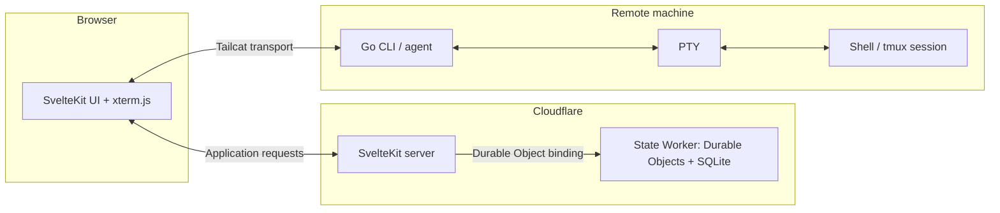

# Planned architecture

WebSSH has three deployable components in one repository:

- `apps/web`: the SvelteKit website, including xterm.js and browser-side Tailcat integration.
- `apps/state`: a Cloudflare Worker exporting SQLite-backed Durable Object classes.
- `apps/cli`: the Go CLI and agent running on the remote machine.

`packages/protocol` will describe the browser–agent contract and hold shared interoperability fixtures.

The SvelteKit server will authenticate and authorize access before using the state binding. Durable Object storage will retain application records; remote tmux sessions will provide process continuity across browser disconnects. The state Worker does not need a public endpoint solely to expose its Durable Objects to the web application.

The first technical milestone is validating xterm.js input/output and resize handling over Tailcat’s experimental browser/WASM transport. Authentication, pairing, object ownership, protocol encoding, and reconnection behavior need to be established during that prototype.

SvelteKit and the Cloudflare state Worker are initialized as pnpm workspaces, with separate Wrangler configurations. The state Worker exports a SQLite-backed Durable Object skeleton; the web Worker declares its external binding. The CLI has an independent Go module with Tailcat installed. Authentication, application storage operations, terminal transport, and protocol implementation remain to be built.
