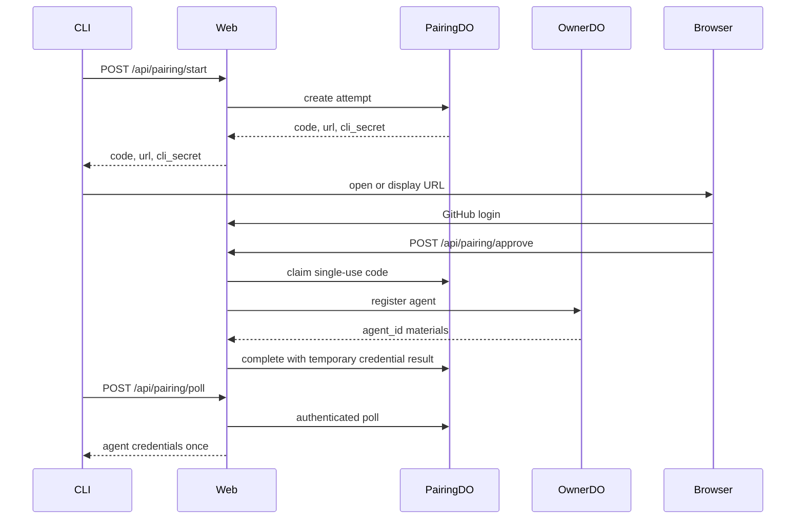

# Identity, pairing, and grants

Status: milestone 2 design, implemented as the first-release access model.

## Scope

Private owner access: one GitHub-authenticated browser owner per account, one browser controller per terminal session. Agents are machines paired to that owner. Collaborative sharing is out of scope.

## Trust boundary

The Cloudflare web Worker and its Durable Object state are **trusted for access control**. They:

- authenticate browser owners
- store ownership and pairing records
- mint short-lived connection grants
- hold hashes of agent credentials and the HMAC keys used to sign grants

A service that can mint grants or that receives raw Tailcat connection material can authorize shell access. This release does **not** claim an untrusted control plane. Stronger isolation (agent-only verification without a central grant mint, or end-to-end pairing where Cloudflare never sees grant keys) would need a separate design and verification.

Terminal bytes travel on Tailcat between browser and agent. Application metadata and grants travel through HTTPS to the web Worker.

## Browser authentication

- Provider: GitHub OAuth (authorization code).
- Session: HttpOnly, Secure, SameSite=Lax cookie signed with `SESSION_SECRET`.
- Cookie payload: session id, owner id, expiry. The owner Durable Object also stores the session row so logout and expiry can revoke server-side.
- Lifetime: 14 days absolute; logout clears the cookie and revokes the session row.
- Missing/invalid/expired/revoked sessions fail closed.

Required Worker secrets/vars: `GITHUB_CLIENT_ID`, `GITHUB_CLIENT_SECRET`, `SESSION_SECRET`, `PUBLIC_ORIGIN`.

Set secrets on the web Worker (never commit them):

```sh
pnpm --filter @webssh/web exec wrangler secret put GITHUB_CLIENT_ID
pnpm --filter @webssh/web exec wrangler secret put GITHUB_CLIENT_SECRET
pnpm --filter @webssh/web exec wrangler secret put SESSION_SECRET
```

`PUBLIC_ORIGIN` is a Wrangler var. The GitHub OAuth app callback must be `{PUBLIC_ORIGIN}/auth/github/callback`. `SESSION_SECRET` must be at least 32 characters.

## CLI

```sh
webssh pair
webssh serve .
```

`webssh pair` calls `POST /api/pairing/start`, prints the approval URL/code, polls `POST /api/pairing/poll`, and writes `~/.webssh/credentials.toml`. `webssh serve` loads that file and verifies attach grants with the stored `grant_key`. `--dev-token` keeps the local `/dev/connect` token available. Without credentials, serve requires explicit `--dev-token`; it otherwise fails closed.

## Durable Object routing

Class: `WebSSHState` (SQLite).

| Object id | Purpose |
| --- | --- |
| `owner:<github_user_id>` | Owner profile, sessions, agents, terminal sessions, grant metadata |
| `pairing` | Short-lived pairing attempts and rate limits |

Authorization never treats a client-supplied Durable Object id, agent id, or session id as proof of access. The web Worker derives the owner object from the authenticated session, then checks that the requested agent/session belongs to that owner.

## Records

Stable ids are public handles. Secrets are stored hashed (or only as HMAC keys with restrictive file modes on the agent). Credentials are never placed in URLs, logs, or ordinary `config.toml`.

| Record | Stable id | Secret / credential |
| --- | --- | --- |
| Owner | `owner_id` (= GitHub user id) | none (OAuth subject) |
| Browser session | `session_id` | cookie authenticity via `SESSION_SECRET` |
| Pairing attempt | `attempt_id` + user-facing `code` | `cli_secret` (one-time poll authenticator) |
| Agent | `agent_id` | `agent_token` (hashed at rest); `grant_key` (HMAC key, stored for minting) |
| Terminal session | `terminal_session_id` | none |
| Connection grant | `grant_id` / nonce | compact signed grant string |

## Pairing flow



Rules:

- Pairing codes expire in 10 minutes, are single-use, and are rate-limited per client IP and overall.
- Approve requires an authenticated browser session.
- Poll requires the `cli_secret` issued at start; replay after completion fails.
- Agent credentials are returned once to the CLI and stored under `~/.webssh/credentials.toml` mode `0600`, separate from settings.

## Agent credentials and grants

After pairing, `webssh serve` loads the agent credential file. Production attach authorization is a **session-scoped HMAC grant**, not a broad per-run application token.

Grant string (attach `token` field):

```text
v1.<terminal_session_id>.<exp_unix>.<nonce>.<base64url_mac>
```

MAC input: `v1\n<agent_id>\n<terminal_session_id>\n<exp_unix>\n<nonce>` using the agent’s `grant_key`.

Properties:

- Minted only for the session owner after ownership checks.
- Short-lived (default 60 seconds to attach; not a long-lived shell capability).
- Bound to `agent_id` and `terminal_session_id`.
- Single-purpose attach; replay of an already-consumed nonce fails when the agent tracks recent nonces (bounded set). Expiry alone is insufficient if the grant is intercepted before first use—prefer short TTL plus nonce replay cache on the agent.
- Revoked agents (credential deleted/rotated server-side) cannot mint new grants; the agent checks current authorization online and closes connections after revocation.

The legacy per-run `--json` token remains **development-only** for `/dev/connect` and local tests. Production session routes must not accept or emit that broad token.

## Acceptance mapping

| Requirement | Mechanism |
| --- | --- |
| Second account cannot access another owner | Owner DO isolation + session-derived routing |
| Expired/replayed pairing codes fail | Expiry, claimed flag, cli_secret check |
| Revoked agent credentials fail | Server refuse mint; agent without matching grant_key rejects |
| Invalid grants never start a PTY | Constant-time MAC verify before `startProcess` |
| Logout/expiry blocks new access | Session row + cookie cleared; grant mint requires session |

## Corrected enforcement and operational limits

The agent performs online admission checks in addition to HMAC verification. Pairing credentials include the HTTPS control-plane origin. `serve` authenticates with its agent token and registers a fresh session ID for that run. The ID appears as `sessionId` in JSON output. Grants for another run are rejected before PTY creation. One live controller is permitted per paired run.

The agent consumes each grant nonce transactionally through the owner DO, checking the issuing browser session and current agent status. Replay is rejected in both the bounded local cache and the DO. Cache capacity fails closed rather than evicting live nonces. Grants expire at their exact expiry second and cannot exceed a 60-second verification window. Nonce consumption persists across agent process restarts; new runs have distinct IDs.

Connected agents recheck authorization every two seconds with a three-second request budget. Revocation, browser-session logout/expiry, credential expiry, or control-plane failure closes the connection and its shell. This intentionally trades offline availability for revocation enforcement. Revocation is bounded by that polling/request interval, not instantaneous. Browser logout is POST-only and does not report success if server-side revocation fails.

Agent tokens expire after 30 days. `webssh pair --renew` rotates the token and atomically saves the replacement; old tokens stop working, including running agents using them. Restart serve after renewal. If the response or local save is lost after rotation, re-pair and revoke the old agent from an authenticated owner session. `pair --replace` explicitly revokes a previous readable credential before replacing its local file. Expired/revoked credentials require a fresh pairing. Grant keys stay private to the control plane and paired agent.

Missing credentials never silently enable legacy auth. Local use requires `webssh serve --dev-token --json <path>`; production paired runs require session binding and online checks. Existing credential files without an origin must be re-paired.

Pairing approval previews the machine name before consent. Claim and delivery are single-use; delivery reads and transitions occur in one SQLite transaction after authentication. Expiry is checked before returning credentials, including completed and claimed attempts. A failed cross-object completion revokes any newly registered agent. Poll retries after successful delivery return expired; delivery lost in transit requires pairing again. A cleanup alarm clears expired delivery secrets and removes old attempts. The temporary result record is trusted plaintext storage, not a sealed envelope.

The tests now execute the real SQLite Durable Object using Miniflare, covering concurrent polls, expiry, owner separation, credential rotation, grant consumption, logout, and revocation. Go regression tests cover replay-cache capacity, run binding, explicit dev mode, and online denial. Actual GitHub OAuth requires a configured OAuth application and has not been exercised against a live GitHub account by these tests. Milestone 3 still owns production address delivery and the full browser session flow.
